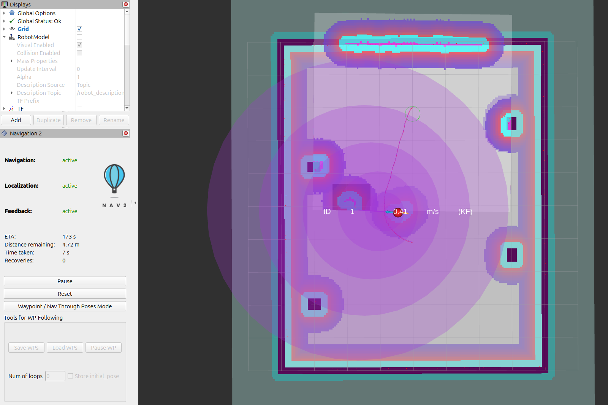
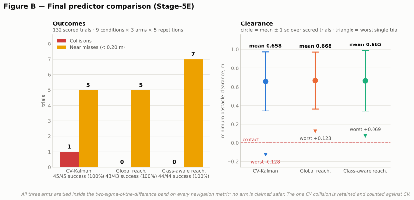
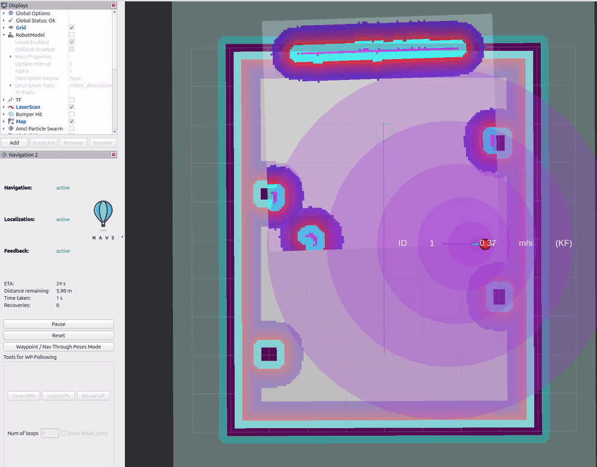
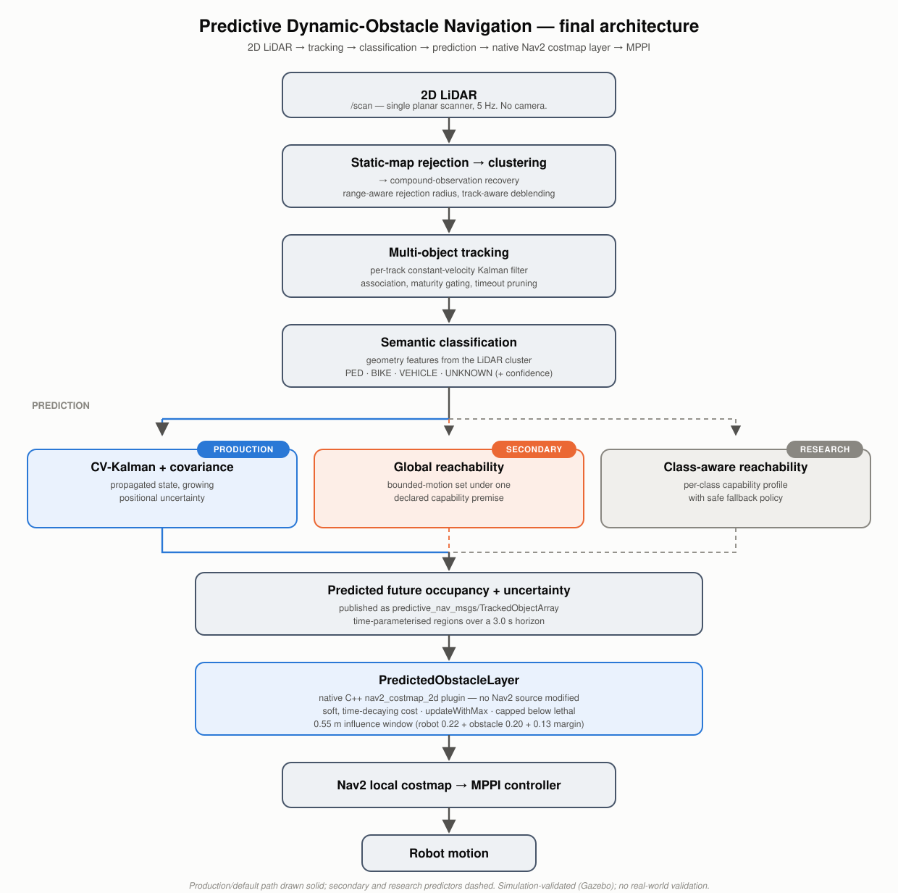
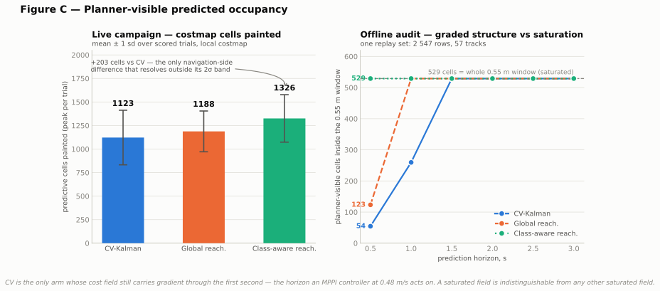
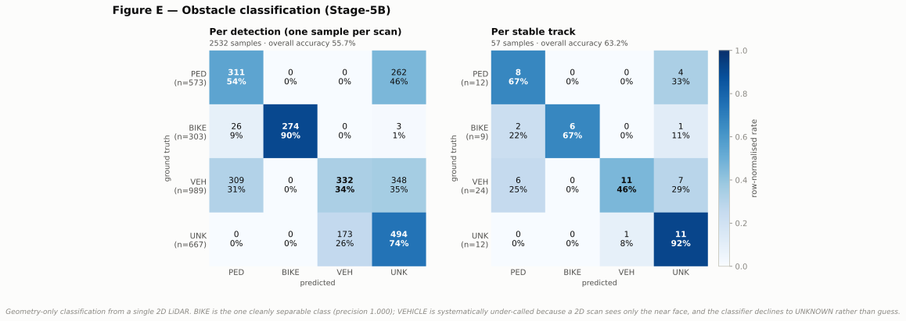
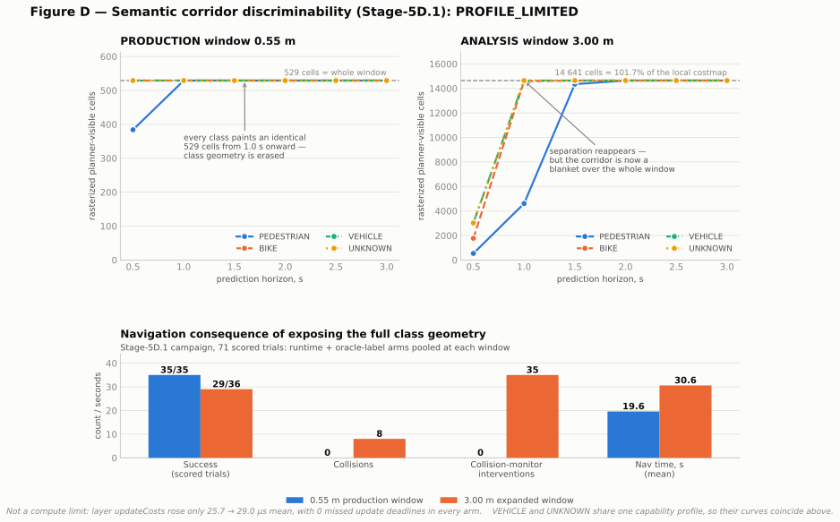

# Predictive Dynamic-Obstacle Navigation for ROS 2 / Nav2

A ROS 2 C++ navigation system that detects and tracks dynamic obstacles from 2D
LiDAR, classifies them, predicts future occupancy, and injects uncertainty-aware
motion predictions into Nav2 for MPPI-based collision avoidance.

**Final architecture:** CV-Kalman production predictor · global reachability as a
secondary representation · class-aware reachability as a research result.
**Simulation validated** (ROS 2 Jazzy + Gazebo Sim 8). No real-world validation is
claimed.



*RViz view of the production CV-predictive stack: tracked obstacle ID and Kalman
velocity estimate, the predicted future uncertainty corridor, and the resulting
Nav2 avoidance trajectory.*

## Headline result — final comparative validation

Stage-5E ran all three predictors over the same nine conditions, same map, same
tracker binary, same Nav2/MPPI configuration — only the predictor differed.
**135 trials attempted, 3 excluded as infrastructure faults, 132 scored.**

| Predictor | Success | Collisions | Near misses (< 0.20 m) | Worst clearance | Predictive cells |
|---|:---:|:---:|:---:|---:|---:|
| **CV-Kalman** *(production)* | 45/45 | 1 | 5 | −0.128 m | 1123 ± 290 |
| Global reachability *(secondary)* | 43/43 | 0 | 5 | +0.123 m | 1188 ± 217 |
| Class-aware reachability *(research)* | 44/44 | 0 | 7 | +0.069 m | 1326 ± 252 |

What the campaign actually established:

- **CV is retained as the production default** — and it is the only arm that
  recorded a collision. That collision is counted against it, not relabelled.
- **Every navigation metric, for every pair of arms, falls inside its
  two-sigma-of-the-difference band.** No arm is claimed safer than another. The
  only difference that resolves is how much costmap each arm paints.
- **CV paints the fewest predictive cells** and is the only predictor whose cost
  field still carries gradient through the first second — the horizon an MPPI
  controller at 0.48 m/s actually acts on.
- **Class-aware reachability achieved perfect declared-capability containment
  (1.0000)** and produced **no planner-level benefit** at the production
  influence window.

> Containment numbers in this project are **not** interchangeable. Capability
> containment is a worst-case set property; CV's observed containment (0.9783 at
> the documented k = 1.5) is a calibration property. CV's 0.9783 must not be read
> against class-aware's 1.0000 as commensurable figures.

Full tables: [`validation/stage5e/TABLES.md`](validation/stage5e/TABLES.md) ·
decision record: [`validation/stage5e/DECISION.json`](validation/stage5e/DECISION.json).

<p align="center">
  
</p>

## Demo



*Perpendicular-crossing trial under the production CV configuration. The tracker
estimates the obstacle state with a Kalman filter, propagates its future motion
and uncertainty into the predictive costmap, and Nav2 MPPI adjusts the trajectory
before the crossing conflict.*

A fuller capture — classification labels, reachability corridors, and a CV
vs reachability side-by-side — is specified with exact commands in
[`docs/DEMO_PLAN.md`](docs/DEMO_PLAN.md); that footage has not been recorded yet.

## System architecture



Input is a **single 2D LiDAR**. There is no camera anywhere in the pipeline.
Everything above the costmap layer runs as a standalone C++ tracker node
publishing `predictive_nav_msgs/TrackedObjectArray` at scan rate; the costmap
layer is a native `nav2_costmap_2d` plugin and MPPI is stock Nav2. **No Nav2 or
MPPI source was modified** — prediction enters the stack purely as an additional
costmap layer plus one reweighted stock critic parameter.

## What the system does

1. **Static-map rejection** with a range-aware radius, so localisation-yaw beam
   drift at long range does not manufacture false dynamic tracks from walls.
2. **Clustering with compound-observation recovery** — two obstacles that fall
   into one connected-component cluster are split using the tracker's own
   Kalman-predicted positions as seeds.
3. **Multi-object tracking** — per-track constant-velocity Kalman filter with
   association, maturity gating and timeout pruning.
4. **Semantic classification** into PED / BIKE / VEHICLE / UNKNOWN from LiDAR
   cluster geometry, with a confidence and an explicit decline-to-UNKNOWN.
5. **Prediction** of future occupancy over a 3.0 s horizon (three predictors,
   below).
6. **Predictive costmap injection** — a native C++ `nav2_costmap_2d::Layer` paints
   predicted occupancy as soft, time-decaying cost, combined with `updateWithMax`
   so it can only add cost on top of sensed geometry, and capped below
   `INSCRIBED_INFLATED_OBSTACLE` so a prediction is never asserted as a sensed
   lethal obstacle.
7. **MPPI** plans against where the obstacle *will be*, not only where it was last
   seen.

## Prediction methods

| Predictor | What it publishes | Role |
|---|---|---|
| **CV-Kalman + covariance** | Propagated filter state with growing positional uncertainty, consumed at k = 1.5σ | **Production / default** |
| **Global reachability** | A time-parameterised bounded-motion set under one declared capability premise (`max_speed`, `max_acceleration`), with a runtime contract that fires when that premise is observably contradicted | **Deployed secondary** — read off the navigation path |
| **Class-aware reachability** | Per-class capability profiles (PED / BIKE / VEHICLE / UNKNOWN) with a safe ambiguity and fallback policy | **Research only** |

All three run from the same tracker binary; the arms differ by one semantic
configuration line each, and every scored trial reads back its own layer mode
(zero mismatches across 132 trials).

## Final architecture decision

**`SHIP_CV`** — decided against a decision rule fixed in writing *before* the
aggregate results existed ([`DECISION_RULE.md`](validation/stage5e/DECISION_RULE.md),
sha256 `cfff14a9…`, fixed at trial 4 of 135, with that timing disclosed in the
rule itself).

The decision rests on: reliable navigation, graded early planner-visible
structure, fewer predictive cells, stable planner interaction, bounded
computation, and adequate observed prediction performance.

It explicitly **does not** rest on any claim of statistical safety superiority —
and it does not claim CV had zero collisions (it had one), nor that CV has better
capability containment (CV is the lowest of the three at 0.0098).

| Component | Status | Why |
|---|---|---|
| CV-Kalman | `SHIP_CV` | Incumbent not displaced by a tie; only arm with graded structure through the first second |
| Global reachability | `DEPLOYED_SECONDARY` | Supplies a falsifiable validity claim and a runtime contract signal CV cannot express, at ~2× area for better observed containment |
| Class-aware reachability | `RESEARCH_ONLY` | Mathematically sound, planner-uninformative as configured |

## Results

<p align="center">
  
</p>

Inside the 0.55 m production influence window (529 cells total), CV paints 54
cells at 0.5 s and 260 at 1.0 s; global reachability saturates from 1.0 s;
class-aware reachability is saturated at **every** horizon including 0.5 s. A
saturated field is indistinguishable from any other saturated field — the planner
cannot act on a distinction it cannot see.

Computation was never the constraint: layer `updateCosts` averaged 24.9–25.4 µs
against a 200 000 µs budget, with **0 layer-rate shortfalls and 0 costmap update
failures** in all three arms.

### Does prediction beat no prediction?

Stage-5E compares predictors against each other. The earlier reactive-vs-predictive
benchmark answers the prior question, under the Stage-4 production configuration:

| condition | reactive clearance | predictive clearance | reactive collisions | predictive collisions | reaction lead |
|---|---:|---:|:---:|:---:|---:|
| perpendicular crossing, 0.50 m/s | 0.133 m | **0.795 m** | 0 | 0 | 1.90 s |
| oblique crossing | 0.121 m | **0.629 m** | 0 | 0 | 2.92 s |
| head-on | −0.010 m | **0.141 m** | **6** | **0** | 1.28 s |
| no-conflict control | 1.136 m | 1.145 m | 0 | 0 | n/a |

The no-conflict control matters as much as the positive rows: with the obstacle
visible, tracked and predicted throughout but never on a collision course,
navigation time differs by 9 ms and path length by 10 mm between arms. The layer
reacts to a specific predicted conflict; it does not penalise every tracked object
generically. Source: [`validation/STAGE4F_README.md`](validation/STAGE4F_README.md)
(120 trials) and [`validation/STAGE4G8_README.md`](validation/STAGE4G8_README.md)
(448-trial robustness pass). **These are earlier-stage results under the Stage-4
configuration, not part of the Stage-5E three-arm campaign.**

## Classification

<p align="center">
  
</p>

Geometry-only classification from a single 2D LiDAR, measured over 2 547 recorded
rows: **55.7%** per-detection and **63.2%** per-track overall accuracy. BIKE is
the one cleanly separable class (precision 1.000); VEHICLE is systematically
under-called because a 2D scan sees only the near face of a large body. The
classifier declines to UNKNOWN rather than guess, which is why the live
class-aware fallback rate is 0.4193 — the class is closed on only 58% of samples
at this sensor fidelity.

Evidence: [`validation/STAGE5B_README.md`](validation/STAGE5B_README.md) ·
[`validation/stage5b1/CLOSEOUT.md`](validation/stage5b1/CLOSEOUT.md).

## Reachability qualification

Reachability here means a **bounded-motion set**: given a declared capability
premise, the region the obstacle could occupy at time *t*. It is a different kind
of object from a Kalman covariance ellipse, which is a probabilistic statement
about where the obstacle is *likely* to be given the filter's noise model.

Containment and region area below are measured offline over one fixed replay set
(2 547 rows, 57 tracks); the contract-breach column is the live count from the
Stage-5E campaign's own tracker counters, which is a different measurement:

| | capability containment | observed containment | mean region area | contract breaches (live campaign) |
|---|---:|---:|---:|---:|
| CV-Kalman | 0.0098 | 0.9783 (k = 1.5) | 24.2 m² | 0 — CV has no premise to breach |
| Global reachability | 0.0171 | 0.9956 | 47.3 m² | 66, all repaired |
| Class-aware reachability | 1.0000 | 1.0000 | 2 151.7 m² | 0 |

The 66 global contract breaches were **estimator overshoots at corner emergence**,
not true physical capability violations — no obstacle in this environment ever
exceeded 0.655 m/s. The mechanism worked as designed on its own terms (it is
defined on *observed* speed), but its value as a detector of a real capability
violation is untested here.

Evidence: [`validation/STAGE5C_README.md`](validation/STAGE5C_README.md) ·
[`validation/stage5c1/STAGE5C1_README.md`](validation/stage5c1/STAGE5C1_README.md) ·
[`validation/stage5d/STAGE5D_README.md`](validation/stage5d/STAGE5D_README.md).

## Why class-aware reachability was not deployed

This is the most informative result in the project, and it is a negative one.

Class-specific reachable sets were **mathematically qualified**: capability
containment 1.0000, zero contract breaches, zero unsafe profile events. The
mathematics is not the problem.

<p align="center">
  
</p>

What the Stage-5D.1 audit found:

- The capability profiles generate large **isotropic** regions — the published
  region is a disc, so it grows in every direction at once.
- The Nav2 **local costmap has limited spatial extent** (6 × 6 m), and the
  production influence window is 0.55 m (robot radius 0.22 + obstacle radius 0.20
  + 0.13 m margin — a conflict-geometry argument, not a tuned constant).
- At that window **the profiles become visually identical**: from 1.0 s onward
  every class paints exactly 529 of 529 cells, on every one of 15 282 samples.
  The underlying continuous geometry differs by 7.3×–18.1× in area; all of it is
  erased by the window.
- **Exposing the full regions blankets the cost field.** At a 3.00 m window the
  class separation reappears — and the corridor becomes a blanket covering 101.7%
  of the local costmap. MPPI has no cost gradient left to express an avoidance
  manoeuvre.
- The consequence is measured, not argued: pooled across the production-window
  arms, **35/35 success and 0 collisions**; pooled across the expanded-window
  arms, **29/36 success, 8 collisions, 35 collision-monitor interventions**, and
  navigation time rising 19.6 s → 30.6 s.
- **It is not a compute limit.** Layer `updateCosts` rose only 25.7 → 29.0 µs mean
  with 0 missed update deadlines. Expanded semantic visibility was computationally
  affordable and navigationally destructive.
- **Perfect labels do not rescue it.** The oracle-label arm at the expanded window
  was the *worst* arm on success and navigation time.

Diagnosis: **`PROFILE_LIMITED`** — the limitation is in the capability profiles
meeting a small policy window, not in the classifier and not in the compute
budget. Class-aware reachability is therefore retained as a **research** result
and as the soundness reference against which the other two predictors are judged,
not deployed in the production architecture.

Evidence: [`validation/stage5d1/STAGE5D1_README.md`](validation/stage5d1/STAGE5D1_README.md).

## Software architecture

| Package | Type | Role |
|---|---|---|
| [`predictive_nav_msgs`](src/predictive_nav_msgs) | `ament_cmake` (rosidl) | `TrackedObject`, `TrackedObjectArray`, `TrackedObjectPrediction`, `ReachabilityPrediction` |
| [`predictive_nav_tracking`](src/predictive_nav_tracking) | `ament_cmake` (C++) | `lidar_obstacle_tracker_node`: static rejection → clustering → compound-observation recovery → association → Kalman filter → classification → CV / reachability prediction |
| [`predictive_nav_costmap`](src/predictive_nav_costmap) | `ament_cmake` (C++, pluginlib) | `PredictedObstacleLayer`, the `nav2_costmap_2d` plugin that turns predictions into costmap cost |
| [`predictive_nav_bringup`](src/predictive_nav_bringup) | `ament_cmake` | Launch files, Nav2 / AMCL / MPPI parameters, Gazebo worlds and maps, RViz configs, and the benchmark scripts that produce `validation/` |

## Reproduce / run

Target environment: **ROS 2 Jazzy**, **Gazebo Sim 8** (`ros_gz_sim`), Ubuntu.

```bash
# build
source /opt/ros/jazzy/setup.bash
rosdep install --from-paths src --ignore-src -r -y
colcon build --symlink-install
source install/setup.bash
```

```bash
# run the production configuration (CV-Kalman, reachability off)
ros2 launch predictive_nav_bringup stage4f_bringup.launch.py \
  params_file:=$(ros2 pkg prefix predictive_nav_bringup)/share/predictive_nav_bringup/config/production_nav2_params.yaml \
  tracker_params:=$(ros2 pkg prefix predictive_nav_tracking)/share/predictive_nav_tracking/config/production_tracker_params.yaml
```

Add `headless:=False use_rviz:=True` to watch it live, including tracked objects,
predicted corridors and uncertainty.

```bash
# functional tests (13 suites)
colcon test --packages-select predictive_nav_tracking predictive_nav_costmap
colcon test-result --verbose

# list the nine campaign conditions and the three arms
python3 validation/stage5e/run_nav5.py --list

# smallest meaningful end-to-end check: one condition, all three arms, one rep
# (--out is an output DIRECTORY; per-trial JSON and logs are written into it)
python3 validation/stage5e/run_nav5.py \
  --conditions ped_cross --arms cv,global,classaware --trials 1 \
  --out ./stage5e_smoke
```

The full Stage-5E campaign is the same runner with its defaults (9 conditions ×
3 arms × 5 repetitions, ~2 h wall time).

## Validation

Evidence is organised one directory per stage under
[`validation/`](validation/README.md), each with its own report, machine-generated
tables and reproduction recipe.

| Stage | What it establishes |
|---|---|
| [Stage-5B](validation/STAGE5B_README.md) | Obstacle classification from 2D LiDAR geometry; confusion matrices and failure analysis |
| [Stage-5B.1](validation/stage5b1/CLOSEOUT.md) | Anti-merge replay and single-binary provenance for the classification dataset |
| [Stage-5C](validation/STAGE5C_README.md) | Mathematical qualification of the existing reachability predictor |
| [Stage-5C.1](validation/stage5c1/STAGE5C1_README.md) | Capability contract and raster-fidelity audit of the costmap layer |
| [Stage-5D](validation/stage5d/STAGE5D_README.md) | Class-aware reachability qualification and its boundary audit |
| [Stage-5D.1](validation/stage5d1/STAGE5D1_README.md) | Semantic corridor discriminability audit → `PROFILE_LIMITED` |
| [Stage-5E](validation/stage5e/STAGE5E_README.md) | Final three-arm comparative campaign and architecture decision |

Earlier Stage-4 evidence (reactive-vs-predictive benchmark, 448-trial robustness
pass, the CV-only prediction-policy decision) is indexed in
[`validation/README.md`](validation/README.md) and remains unmodified.

The Stage-5E campaign's compact machine-readable evidence is committed under
[`validation/stage5e/`](validation/stage5e). The 406-file raw simulator output
(135 trial JSONs, 135 series JSONs, 135 per-trial logs) is deliberately kept
outside the repository and is not tracked in Git.

Figures A–E are regenerated from that committed evidence by
[`docs/figures/make_figures.py`](docs/figures/make_figures.py).

## Limitations

- **Simulation only.** Gazebo, headless, one map, one robot, one sensor model. No
  real robot validation, and none is claimed.
- **2D LiDAR only.** No camera, no sensor fusion.
- **Classification is geometry-based**, and pedestrian/vehicle ambiguity is
  intrinsic to 2D scan geometry — a planar scan sees the near face of a vehicle,
  not its extent.
- **Scripted obstacles are not reactive.** Actors never avoid the robot and have
  no collision response. This bounds how much any predictor can help, and it
  affects all three arms equally.
- **Reversal and multi-obstacle conditions were not included** in the final
  equivalent three-arm Stage-5E campaign. The shared validated runner drives one
  obstacle at constant one-way velocity and the shared launch spawns one obstacle;
  changing either would have broken the freeze and the comparability. Earlier-stage
  results on those conditions exist but are supporting evidence only and are not
  counted in the 135 attempted or 132 scored trials.
- **The CV collision is counted.** One collision in 45 CV trials, retained against
  CV and not relabelled as infrastructure.
- **No claim of universal predictor superiority.** n = 5 per cell is enough to
  show the arms are tied inside a crude noise band; not enough to resolve a
  rare-event difference.
- **Global's contract signal has no true positive in this environment** — all 66
  firings were estimator transients.
- **The predictive layer is time-agnostic**: it paints the whole swept future
  corridor at once, so MPPI cannot reason "I will be there after the obstacle has
  passed". A time-parameterised costing scheme would need a custom critic, which
  was deliberately not written.

## Future work

Scientifically justified, none implemented:

- anisotropic / directional reachable sets instead of isotropic discs
- intent-conditioned prediction
- CTRV / manoeuvre motion models
- IMM (interacting multiple model) estimation
- camera–LiDAR semantic fusion
- learned multimodal prediction
- real outdoor robot validation

## Repository structure

```
src/
  predictive_nav_msgs/        prediction and tracking message definitions
  predictive_nav_tracking/    LiDAR tracker, classifier, predictors (C++)
  predictive_nav_costmap/     PredictedObstacleLayer Nav2 plugin (C++)
  predictive_nav_bringup/     launch, params, worlds, maps, RViz, benchmarks
validation/                   per-stage evidence, reports and machine-readable data
docs/
  images/                     architecture figure and results figures A–E
  media/                      demo capture
  figures/make_figures.py     regenerates figures A–E from validation/
  PROJECT_SUMMARY.md          short project summary
  INTERVIEW_TALK_TRACK.md     technical talk track
  DEMO_PLAN.md                demo capture plan and exact commands
```
